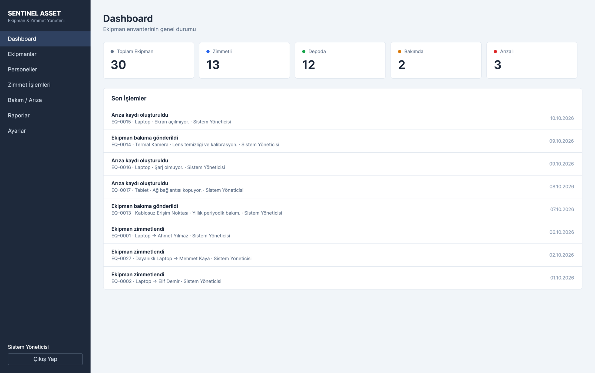
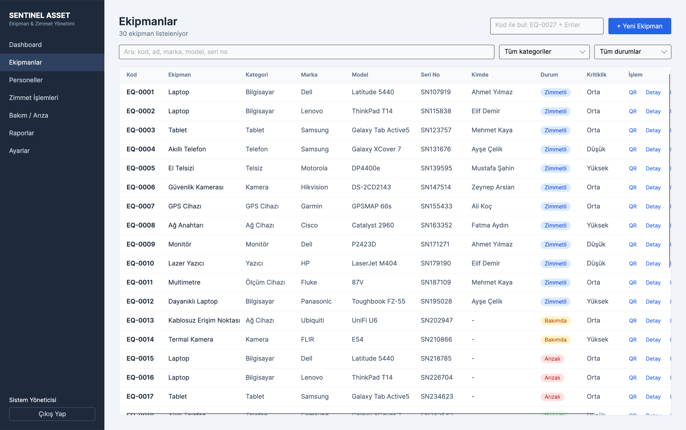
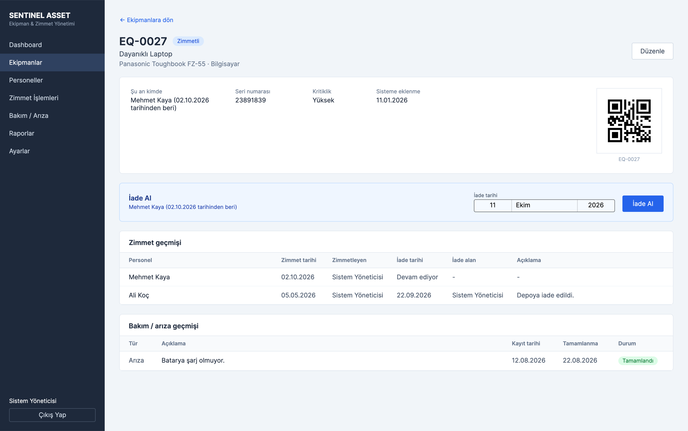
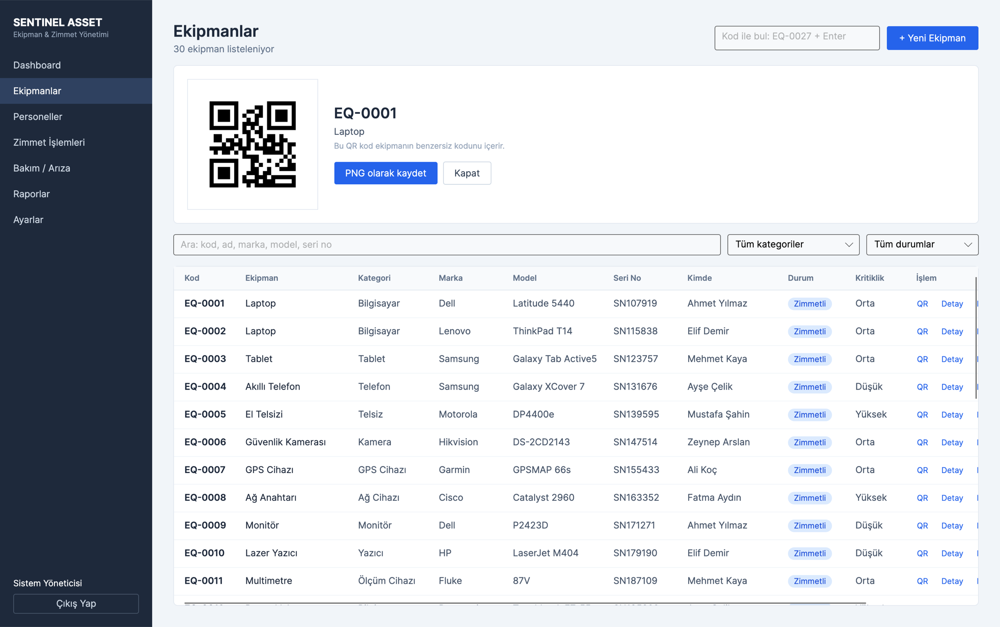
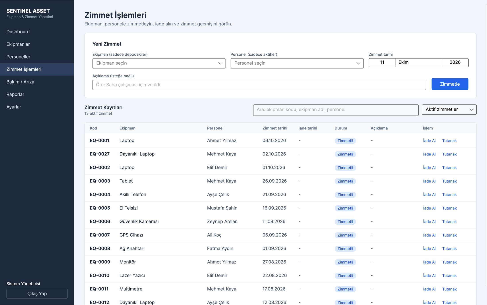
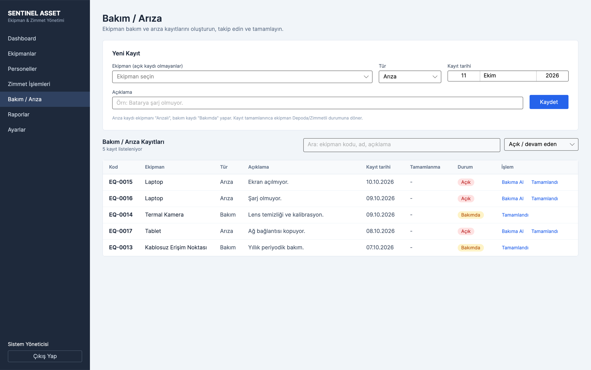
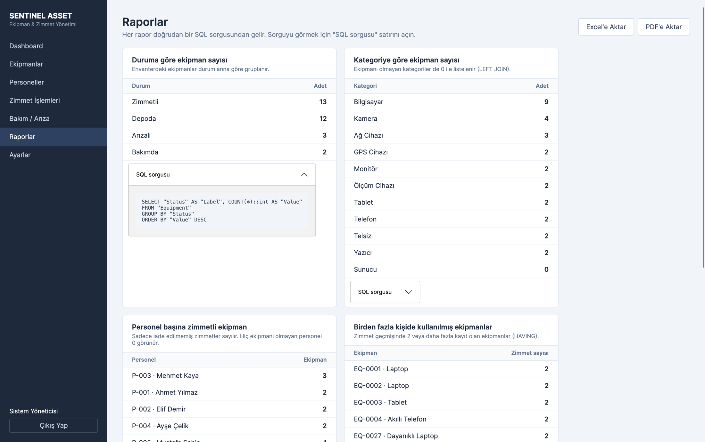
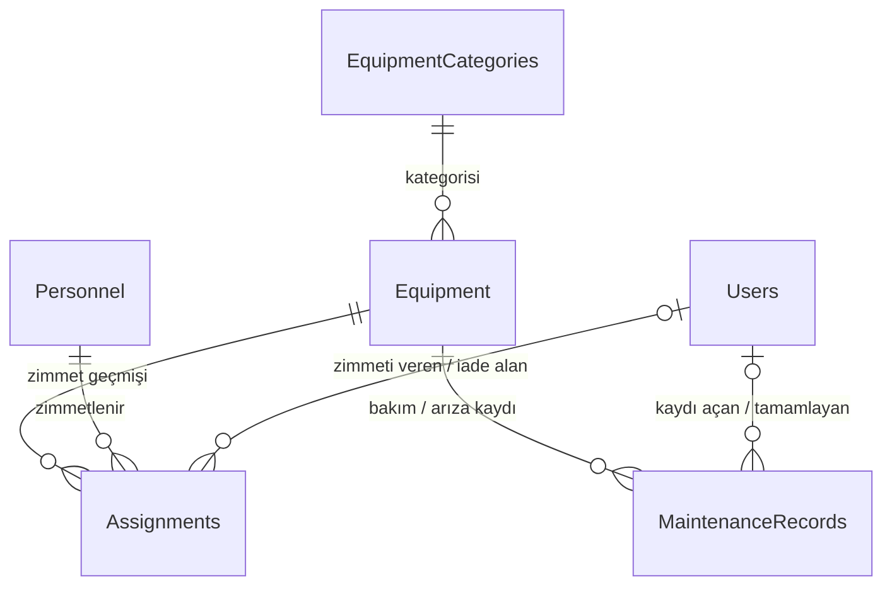

# Sentinel Asset

**Teknik ekipman ve zimmet yönetim otomasyonu.** Bir kurumdaki ekipmanların envanterini, kimde olduğunu, zimmet ve iade geçmişini
ve bakım / arıza kayıtlarını takip eden masaüstü uygulaması.

> Bu depo projenin **tanıtımıdır**. Kaynak kod özeldir (private) ve yalnızca değerlendirme amacıyla, izin verilen kişilerle paylaşılır.
> İnceleme için GitHub profilimden ([@merveozberk1](https://github.com/merveozberk1)) bana ulaşabilirsiniz.

C# · .NET 10 · Avalonia UI · Entity Framework Core · PostgreSQL · Docker

---

## Ekran görüntüleri

### Dashboard
Ekipman durumlarının özeti ve son işlemler. Her işlemin yanında **işlemi yapan kullanıcı** da görünür.



### Ekipmanlar
Arama, kategori ve durum filtresi. Her satırda ekipmanın **kimde olduğu** görünür; satırdan QR kod, detay, düzenleme ve silme işlemlerine ulaşılır. Üstteki "Kod ile bul" kutusu, kodu yazıp Enter'a basınca (veya QR okuyucuyla okutunca) ekipman kartını açar.



### Ekipman kartı
Bir ekipmanla ilgili her şey tek ekranda: durum, şu an kimde olduğu, seri numarası, **QR kodu**, **tüm zimmet geçmişi** (kime, ne zaman verildi, kim iade aldı) ve **bakım / arıza geçmişi**. Aynı ekrandan tek tuşla iade alınabilir veya zimmetlenebilir.



### QR kod
Her ekipman için benzersiz kodunu içeren QR kod üretilir ve PNG olarak kaydedilebilir.



### Zimmet işlemleri
Yeni zimmet formu ve zimmet kayıtları. Formda yalnızca **depodaki ekipmanlar** ve **aktif personel** seçilebilir. İade edilen kayıtlar silinmez, "Tüm geçmiş" filtresiyle görülebilir. Her kayıt için imzalı **zimmet tutanağı (PDF)** alınabilir.



### Bakım / arıza
Arıza veya bakım kaydı açıldığında ekipmanın durumu otomatik değişir (Arızalı / Bakımda). Kayıt "Bakıma Al" ve "Tamamlandı" adımlarından geçer; tamamlanınca ekipman Depoda veya Zimmetli durumuna döner.



### Raporlar
Her rapor doğrudan bir SQL sorgusundan gelir ve sorgu ekranda görülebilir (GROUP BY, LEFT JOIN, HAVING). Raporlar **Excel** ve **PDF** olarak dışa aktarılabilir.



---

## Özellikler

- **Ekipman yönetimi:** ekleme, düzenleme, silme, arama, kategori ve durum filtresi, QR kod üretimi
- **Ekipman kartı:** tek ekranda durum, kimde olduğu, zimmet geçmişi, bakım geçmişi. Kodu yazıp Enter'a basmak (veya QR okuyucuyla okutmak) kartı açar
- **Zimmet ve iade:** geçmiş kaybolmaz, "bu ekipman daha önce kimlerde kullanılmış?" sorusu cevaplanır
- **Bakım / arıza takibi:** kayıt açma, bakıma alma, tamamlama; ekipman durumu otomatik güncellenir
- **Personel yönetimi:** T.C. kimlik no (algoritmayla doğrulanır) veya pasaport no, ülke koduyla telefon doğrulama, personel detay sayfası
- **Raporlar:** doğrudan SQL ile üretilen raporlar, Excel ve PDF dışa aktarma
- **Zimmet tutanağı:** imza alanlı PDF belgesi
- **Güvenli giriş:** hash'lenmiş şifreler, hatalı deneme sınırı, ilk kurulumda yönetici hesabının belirlenmesi
- **Dayanıklılık:** veritabanına ulaşılamazsa uygulama çökmez, anlaşılır bir hata ekranı ve "Tekrar Dene" sunar

## Tasarım kararları ve iş kuralları

- Bir ekipman aynı anda yalnızca **bir** personele zimmetlenebilir. Kural hem uygulama kodunda hem **veritabanında** (kısmi benzersiz indeks) korunur.
- İade edilince zimmet kaydı silinmez, iade tarihi doldurulur: **geçmiş korunur**.
- Zimmet veya bakım geçmişi olan ekipman ve personel silinemez (foreign key `RESTRICT`).
- Bakımdaki / arızalı ekipman zimmetlenemez. Ekipman durumu zimmet ve bakım işlemleriyle otomatik değişir.
- Hangi kullanıcının hangi işlemi yaptığı kaydedilir.

## Veritabanı

Altı tablo ve foreign key ilişkileri:



Zincir: **Personel → Zimmet → Ekipman → Bakım kaydı**

Örnek sorgular (uygulamadaki raporların temeli):

```sql
-- Şu an hangi ekipman kimde? (3 tablo JOIN)
SELECT e."Code", e."Name", p."FirstName" || ' ' || p."LastName" AS "Personel"
FROM "Assignments" a
JOIN "Equipment" e ON e."Id" = a."EquipmentId"
JOIN "Personnel" p ON p."Id" = a."PersonnelId"
WHERE a."ReturnDate" IS NULL
ORDER BY e."Code";

-- Duruma göre ekipman sayısı (GROUP BY + COUNT)
SELECT "Status", COUNT(*) AS "Adet"
FROM "Equipment"
GROUP BY "Status"
ORDER BY "Adet" DESC;
```

## Kullanılan teknolojiler

| Katman | Teknoloji |
|---|---|
| Dil / platform | C#, .NET 10 |
| Arayüz | Avalonia UI (MVVM) |
| Veri erişimi | Entity Framework Core, Npgsql, ham SQL (raporlar) |
| Veritabanı | PostgreSQL 16 (Docker) |
| Raporlama | QuestPDF (PDF), ClosedXML (Excel), QRCoder (QR kod) |
| Test | xUnit, 59 otomatik test (iş kuralları, veritabanı kısıtları, güvenlik, doğrulayıcılar) |

Avalonia sayesinde uygulama çok platformludur. macOS üzerinde geliştirildi ve test edildi.

## Gelecek planları

Ağ cihazı izleme sistemi (Network Sentinel) ile birleştirilip fiziksel varlık ve ağdaki cihaz takibinin tek platformda toplanması.

---

© 2026 Merve Özberk. Tüm hakları saklıdır. Bu depodaki metin ve görseller izin alınmadan kopyalanamaz veya kullanılamaz.
